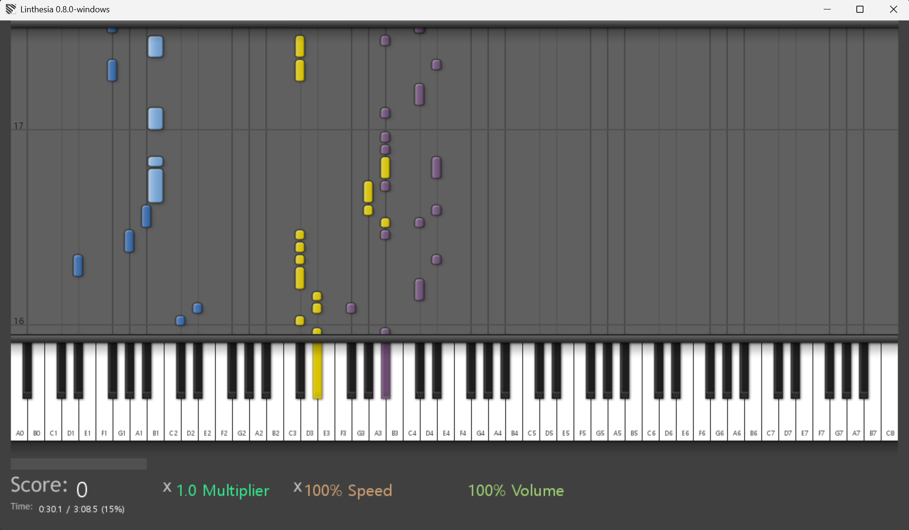

# Linthesia

This fork of [Linthesia](https://github.com/linthesia/linthesia) adds a native
Windows 10/11 x64 port with WinMM MIDI, Unicode file paths, and portable EXE
packaging. See the [Windows build guide](WINDOWS-BUILD.ko.md) for setup and use.

Linthesia is a fork of the Windows/Mac game called Synthesia. It is a game of playing music using a MIDI keyboard (or your PC keyboard), following a .mid file.

Synthesia up to version 0.6.1a is Open Source. This project uses the latest source from sourceforge.

## Build

### Windows 10/11 (64-bit)

The Windows port uses native WinMM MIDI input/output and Windows MIDI Mapper
for built-in sound. Extract the entire portable ZIP and run `Linthesia.exe`;
keep the DLLs, `graphics`, and `music` beside it.

To build from source, install the MSYS2 UCRT64 dependencies listed in
[WINDOWS-BUILD.ko.md](WINDOWS-BUILD.ko.md), then run `build-windows.cmd`.
The script builds with CMake, runs the parser and Windows integration checks,
and writes `dist/windows-x64/Linthesia-windows-x64.zip` with its runtime DLLs.
The `Windows executable` GitHub Actions workflow builds the same package.

### Linux

To compile, you need a basic c++ toolchain, and satisfy all dependences which are on BUILD-DEPENDS file. Then, just:

    $ meson --prefix /usr build
    $ ninja -C build
    $ ninja -C build install #probably with sudo

## How to use
- In most case, just run `/usr/bin/linthesia` binary, and Enjoy :-)
- Linthesia provides you with several musics that will be installed in `/usr/share/linthesia/music/` you can use `--lib-path` to define an other path when required. (read `linthesia -h` since last used path is preserved).
- Linthesia will use anything it finds to play sound. You might want to install `fluidsynth` or `TiMidity++` to run the midi server required for it to produce a sound. You keyboard might provide output that can (probably) be used too, if wanted.

## Credits

Visit https://github.com/linthesia/linthesia for more info.

Join the chat at https://gitter.im/linthesia/linthesia
